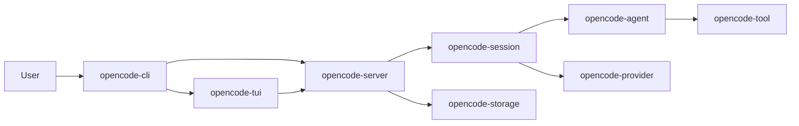

## 概要

OpenCodeRust は Rust 2021 の Cargo workspace で構成される、OpenCode の
Rust 実装・発展プロジェクトである。CLI、TUI、HTTP サーバーを入口として、
session、agent、tool、provider、MCP、LSP などの機能を組み合わせる。

この文書は現在のリポジトリ構成を説明する。公式 OpenCode との完全な機能
互換性を主張するものではない。機能の詳細・実装状況は各 crate の文書と
コードを正とする。

## ワークスペース

Workspace は `Cargo.toml` の `members` に列挙された21 crate から成る。

### 起動・ユーザーインターフェース

- `opencode-cli`: `opencoderust` バイナリ、コマンド解析、実行モード選択。
- `opencode-tui`: 対話型 terminal user interface。
- `opencode-server`: HTTP、SSE、WebSocket API とサーバー状態管理。
- `opencode-pty`: pseudo-terminal の生成と入出力中継。

### Session・agent 実行

- `opencode-session`: session/message model、prompt loop、状態・履歴処理。
- `opencode-agent`: agent 定義、登録、実行制御。
- `opencode-tool`: built-in tool、tool registry、実行と権限要求。
- `opencode-command`: slash command の登録・テンプレート展開。

### Model・外部連携

- `opencode-provider`: provider registry、model 解決、provider adapter。
- `opencode-mcp`: Model Context Protocol client と接続管理。
- `opencode-lsp`: Language Server Protocol client と registry。
- `opencode-plugin`: plugin hook と TypeScript subprocess bridge。
- `opencode-local-llm`: local model 用の補助 binary。

### 設定・永続化・共通基盤

- `opencode-config`: 設定の読み込み、検証、merge。
- `opencode-storage`: SQLite database、migration、repository。
- `opencode-types`: crate 間で共有する型。
- `opencode-core`: ID、event bus などの基盤機能。
- `opencode-permission`: permission rule と判定処理。
- `opencode-watcher`: filesystem change watcher。
- `opencode-grep`: file/text search abstraction。
- `opencode-util`: filesystem、logging 等の共通 utility。

## 主要な実行経路

### CLI・TUI・server



図は主要な機能呼び出しを示す。全 crate の直接依存関係を示す図ではない。
CLI は TUI、単発実行、server 起動などの入口を提供する。TUI と外部 client
は server API を通じて session を操作し、server は session prompt 実行、
provider 選択、tool 権限確認、状態の永続化を調整する。

### Session prompt

1. API または UI から session と prompt を指定する。
2. server が model/provider と agent 設定を解決する。
3. session prompt runner が provider に要求し、必要に応じて tool を実行する。
4. session/message の更新を server event として通知し、storage へ同期する。

`prompt_async` は `session_input` に queue record を先に保存する。worker は
session 単位の FIFO で item を claim し、queue ID を user message ID として
使う。status、recovery、単一 server process の制約は
[ADR-0004](adr/adr-0004-durable-session-input-queue.md) を参照。

## 境界と運用

- Rust workspace は edition 2021、version `0.1.0`。
- crate 間の共有型は `opencode-types`、永続化は `opencode-storage` が担当。
- storage-backed server は SQLite migration を起動時に適用する。
- 同じ SQLite database を使う server は1 process に限定する。
  session snapshot は process memory にあり、複数 process 間の更新調停は
  実装されていない。
- API の認証、CORS、permission の判断は各機能文書と ADR を参照する。
- 公式 OpenCode との差分は `ALIGNMENT.md` と実装を照合する。README の
  feature list は利用可能な機能領域の案内であり、完全な互換性の保証では
  ない。

## 検証

workspace 全体の標準検証コマンド:

```bash
cargo fmt --all -- --check
cargo check --all-targets
cargo clippy --all-targets -- -D warnings
cargo test --workspace
```

## 文書案内

- [文書インデックス](README.md)
- [ユーザーガイド](../USER_GUIDE.md)
- [CLI](opencode-cli.md)、[TUI](opencode-tui.md)、[Server](opencode-server.md)
- [Session](opencode-session.md)、[Agent](opencode-agent.md)、
  [Tool](opencode-tool.md)
- [Provider](opencode-provider.md)、[Storage](opencode-storage.md)、
  [Config](opencode-config.md)
- [Architecture Decision Records](adr/)
- [公式機能との整合計画](../ALIGNMENT.md)
